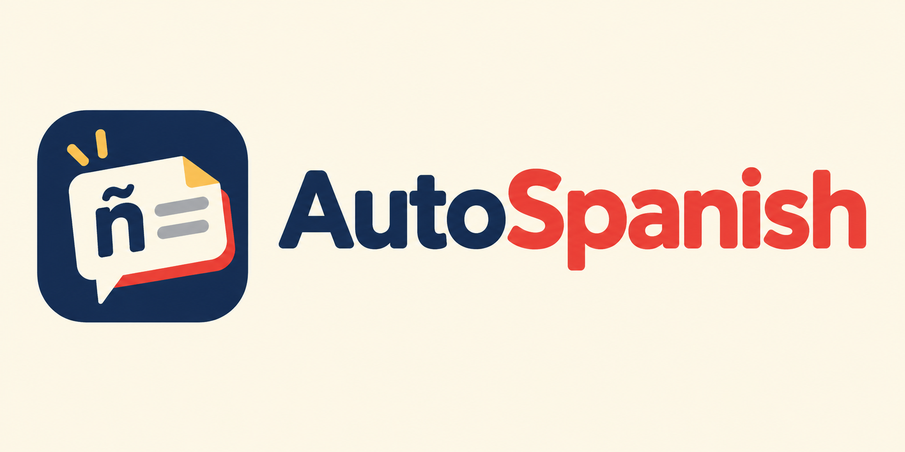
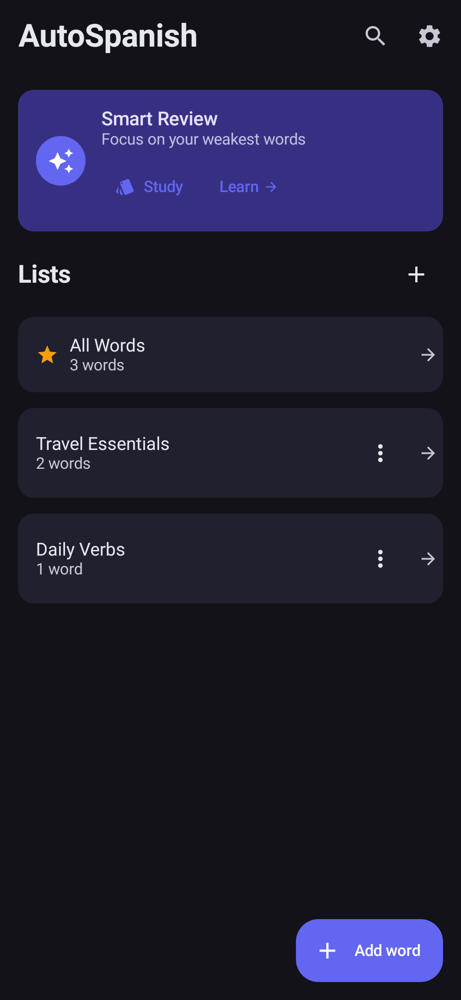
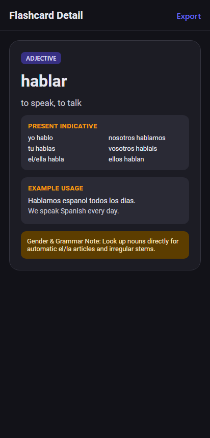

  

# AutoSpanish

**Turn any Spanish or English word into a grammar-annotated flashcard on Android, complete with offline dictionary entries, verb conjugations, and study modes.**

AutoSpanish ships with ~78,900 Wiktionary-derived Spanish headwords covering noun gender, plural forms, adjective pairs, full conjugation tables, and false-friend warnings, paired with flashcards and Learn mode quizzes.

---

## Download

| Platform | Download | Setup Guide |
| :--- | :--- | :--- |
| Android | [AutoSpanish-Android.apk](https://github.com/DontKwo/AutoSpanish/releases/latest/download/AutoSpanish-Android.apk) | [Android APK Install Guide](docs/APK_INSTALLATION.md) |

---

## Screenshots

  
  

---

## How to Use

1. Download `AutoSpanish-Android.apk` from the table above on your Android device.
2. Follow the [Android APK Installation Guide](docs/APK_INSTALLATION.md) to allow installing APKs and bypass Android Play Protect prompts.
3. Type or scan a Spanish or English word on the Home screen to inspect gender, conjugations, examples, and false-friend hints.
4. Save words into your study lists and practice directly with **Flashcards** or **Learn Mode**.

---

## Key Features

- **Offline Spanish Dictionary**: Bundles ~78,900 English-Spanish headwords, conjugation tables, and curated irregular grammar rules without needing internet access.
- **ML Kit & Online Fallback**: Downloads on-device ML Kit models in Settings or queries MyMemory when looking up rare multi-word phrases online.
- **No-Deck List Study & Exports**: Study lists directly in Flashcards or Learn Mode and export lists to CSV, Quizlet text, PDF, or DOCX.

---

## Documentation

### User Documentation
- [User Guide](docs/USER_GUIDE.md)
- [Android APK Installation Guide](docs/APK_INSTALLATION.md)
- [Frequently Asked Questions](docs/FAQ.md)

### Developer Documentation
- [Developer Guide](docs/DEVELOPMENT.md)
- [Developer uv Installation](docs/UV_INSTALLATION.md)

### AI & Technical Documentation
- [AI Agent Reference](AGENTS.md)

### Legal & Security Policies
- [Security Policy](SECURITY.md)
- [Third-Party Notices](THIRD_PARTY_NOTICES.md)
- [MIT License](LICENSE)

---

## Safety & Disclaimers

- **Official `main` Releases Only**: Download APKs exclusively from [DontKwo/AutoSpanish Releases](https://github.com/DontKwo/AutoSpanish/releases/latest) (`main` branch). Never install forked APK builds unless you are sure they contain no malware; only official `main` releases are maintained by the author, and I make no promises.
- **Phone Security Warnings**: Your phone and Google Play Protect will likely warn that installing unknown APKs is unrecognized, unsafe, or not recommended. Bypassing these warnings is strictly at your own discretion using [Android APK Installation Guide](docs/APK_INSTALLATION.md).
- **Educational & AS-IS Disclaimer**: Provided "AS IS" under the [MIT License](LICENSE) with zero warranty; automated translations, dictionary glosses, and grammar hints may contain mistakes and are used at your own risk.
